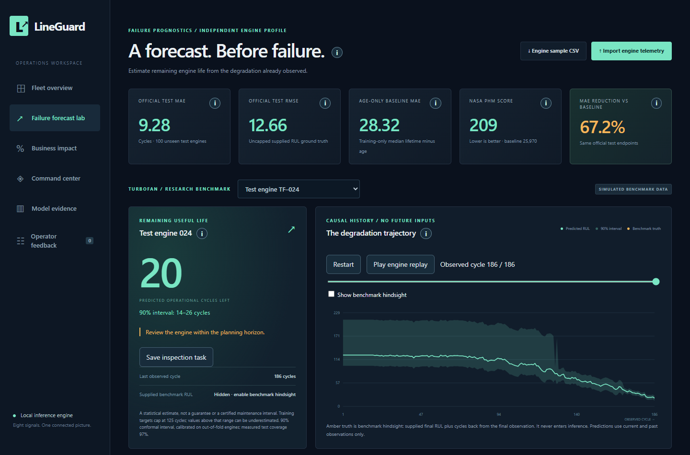
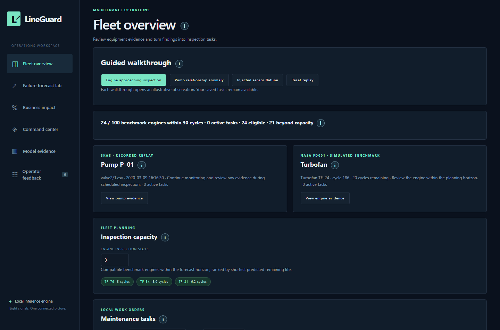
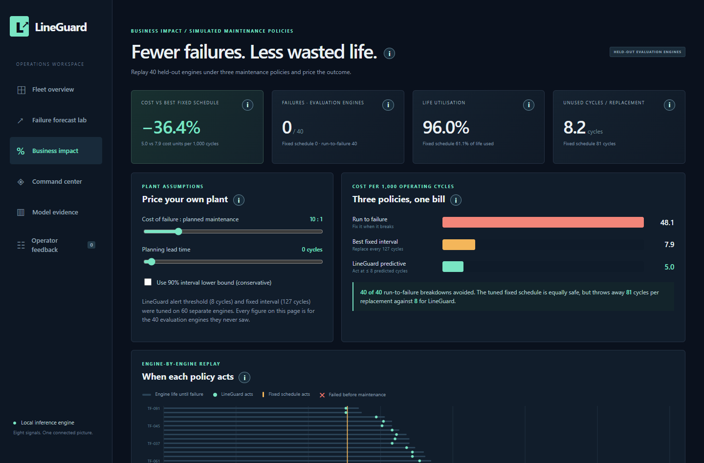
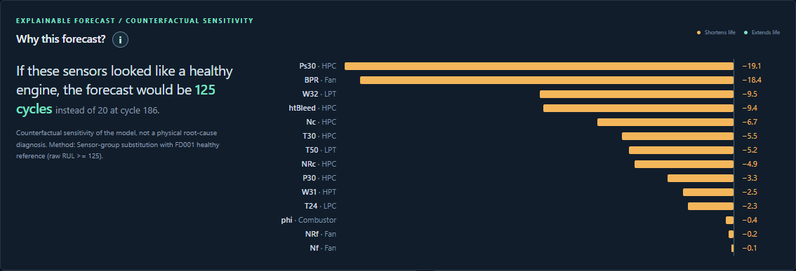
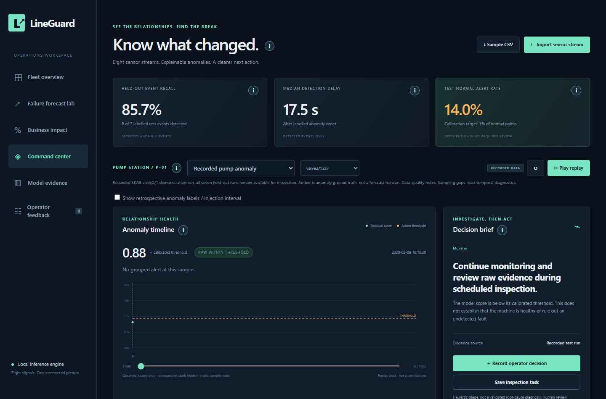
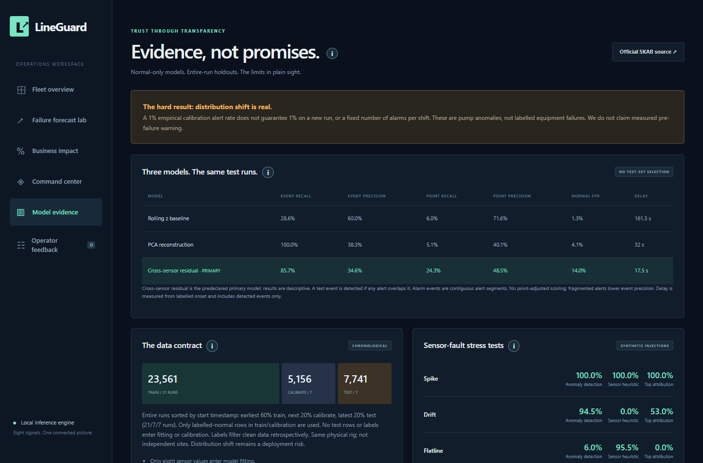

# LineGuard: know what will fail, and why

**Author:** Anshu Gupta (IIT Patna)

LineGuard reads industrial sensor streams and:
1. predicts **how many operating cycles a machine has left**, with a calibrated uncertainty range,
2. explains **why**: which sensors are shortening the forecast, and which pump sensor relationships broke,
3. proves the **business case**: on held-out engines, forecast-driven maintenance costs **36% less** than the best fixed schedule, with **zero** failures and **96%** of component life used (the fixed schedule uses 61%).

Everything runs locally in Python. No GPU, cloud or API key is required.


| Engine failure forecast (NASA C-MAPSS FD001, official test set) | |
|---|---|
| Mean absolute error | **9.28 cycles** (age-only baseline: 28.32, so **67% lower**) |
| RMSE / NASA PHM score | **12.66** / **209** (baseline: 37.78 / 25,970) |
| Within 40 cycles of failure | **2.5 cycles** MAE |
| "Inspect within 30 cycles" alert | catches **23/25** failing engines, **1** false alarm in 75 healthy ones |
| 90% conformal interval | **97%** measured test coverage |
| Same recipe on all 4 NASA subsets | RMSE (truth capped at 125) **11.3 / 10.8 / 9.6 / 11.3** on FD001–FD004 |
| Maintenance cost vs best fixed schedule | **−36%**, 0 failures, 96% life used (40 held-out engines) |

---

## 1. Problem

Unplanned downtime costs the world's 500 largest companies about **$1.4 trillion a year, roughly 11% of revenue** ([Siemens, *True Cost of Downtime 2024*](https://assets.new.siemens.com/siemens/assets/api/uuid:1b43afb5-2d07-47f7-9eb7-893fe7d0bc59/TCOD-2024_original.pdf)). Most plants still maintain on fixed schedules, which wastes healthy parts, or react after breakdowns, which is expensive and unsafe. A useful predictive-maintenance system must answer three questions an engineer actually asks:

| Question | LineGuard module | Data |
|---|---|---|
| *How long until this fails?* | **Failure forecast lab**: remaining-useful-life (RUL) regression with a 90% interval | NASA C-MAPSS FD001 turbofan run-to-failure (simulated) |
| *What exactly changed in the sensors?* | **Command center**: cross-sensor relationship model with per-sensor evidence | SKAB, a real water-pump testbed with labelled anomalies |
| *What do I do about it?* | **Fleet overview**: inspection capacity planner, task lifecycle, evidence report, operator feedback | Both |

The two datasets come from different machines, so each has its own model. Nothing is "fused" across machines that never shared a sensor.

## 2. Approach

### Remaining-life forecasting (engines)
- **Degradation-drift features:** for each of 14 informative sensors, we compute an exponentially smoothed reading, its **drift from that engine's own early-life baseline** (this removes unit-to-unit manufacturing offsets and was the biggest single gain), and trailing means and least-squares slopes over 10 and 30 cycles. All features are **causal**, and a unit test verifies that no future value can leak in.
- **Model:** gradient-boosted trees (`HistGradientBoostingRegressor`) on a piecewise-linear target capped at 125 cycles.
- **Honest selection:** 5-fold **engine-grouped** cross-validation with 500 random truncation points chose among 3 predefined candidates. The selected model was refit and then scored **once** on NASA's official 100-engine test set.
- **Uncertainty:** a **split-conformal** 90% interval, calibrated per predicted-RUL band on out-of-fold residuals. It is about ±6 cycles near failure and wider for healthy engines, which is exactly when uncertainty should be high.
- **Explainability:** for every forecast, each sensor group is swapped for its healthy-engine reference and the model is re-run. The change shows how many cycles that sensor is costing. For example, engine 24's forecast is 20 cycles: Ps30 (HPC static pressure) accounts for −19 of them and BPR (bypass ratio) for −18. This measures the model's sensitivity; it is not presented as a physical root-cause diagnosis.
- **Generalises:** the same predeclared recipe runs on FD002–FD004, the harder multi-condition, multi-fault subsets. Sensors are first z-scored per operating regime (KMeans on the settings, fitted on training data only). An ablation shows this normalisation cuts capped RMSE from 18.1 to 10.8 on FD002 and from 24.1 to 11.3 on FD004.
- **Decision layer:** a planning-horizon slider shows the live confusion matrix, precision and recall across all 100 test engines. A capacity planner ranks engines for the next inspection slots.

### Anomaly explanation (pumps)
- **Cross-sensor residual model:** 8 ExtraTrees regressors, each predicting one sensor from the other seven, trained on normal operation only. When a relationship breaks, the residuals show *which* sensor deviates and by how much: observed vs expected.
- **Sensor-integrity heuristics** (flatline and spike) separate "check the sensor" from "investigate the machine".
- Compared against rolling z-score and PCA baselines on whole-run chronological splits (21 train / 7 calibration / 7 test).

### From forecast to money: maintenance policy simulation
Every FD001 training engine is replayed cycle by cycle on **out-of-fold** forecasts, so each engine is predicted by a model that never saw it. Three policies are compared: run-to-failure; the **best fixed replacement interval**, tuned with knowledge of true lifetimes, which makes it a strong competitor; and **LineGuard predictive**, which acts when the forecast crosses a threshold. Both the fixed interval and the predictive threshold are tuned on 60 engines and reported on **40 unseen engines**. The **Business impact** screen makes the cost ratio, planning lead time and conservative interval-lower-bound mode editable.

### Operations workflow
- Inspection tasks with server-issued evidence IDs, model fingerprints and a status audit trail. Tasks move through open → acknowledged → completed or cancelled.
- A downloadable HTML evidence report for each task.
- Operator verdicts (real fault / false alarm / sensor issue) persist in SQLite.
- CSV upload for new engine or pump data, with schema and cadence validation. Uploaded data never gets invented ground truth.

## 3. Results

### Engine RUL: official FD001 test (100 unseen engines)

| Model | MAE | RMSE | RMSE (truth capped 125) | NASA score ↓ |
|---|---:|---:|---:|---:|
| Age-only baseline | 28.32 | 37.78 | 37.00 | 25,970 |
| Our v1 (trailing-window features) | 12.44 | 16.84 | – | – |
| **LineGuard v2 (drift features, GB)** | **9.28** | **12.66** | **11.31** | **209** |

Cross-validation chose the configuration (CV MAE: GB·drift 17.71, ExtraTrees·drift 19.24, GB·v1 features 24.18, baseline 43.99). The test set was used once. Full protocol, per-engine predictions, interval bands and file hashes are in [`models/prognostics_metrics.json`](models/prognostics_metrics.json) and the [model card](docs/PROGNOSTICS_MODEL_CARD.md).

### Business impact: 40 held-out engines (cost of an unplanned failure = 10× a planned job)

| Policy | Failures | Mean unused life per replacement | Life used | Cost per 1000 cycles |
|---|---:|---:|---:|---:|
| Run to failure | 40 / 40 | 0 | 100% | 48.07 |
| Best fixed interval (127 cycles) | 0 | 81 cycles | 61% | 7.87 |
| **LineGuard predictive** | **0** | **8 cycles** | **96%** | **5.01 (−36%)** |

With a 10-cycle planning lead time, LineGuard is still 35.6% cheaper than the fixed schedule. Costs are relative assumptions that can be edited in the app, and the engines are simulated. [`app/policy.py`](app/policy.py) holds the full protocol.

### Generalisation: all four NASA C-MAPSS subsets (official test sets, evaluated once)

| Subset | Conditions / faults | Test engines | MAE | RMSE | RMSE (truth capped at 125) | NASA score |
|---|---|---:|---:|---:|---:|---:|
| FD001 | 1 / 1 | 100 | 9.28 | 12.66 | 11.31 | 209 |
| FD002 | 6 / 1 | 259 | 14.61 | 23.11 | 10.76 | 3,783 |
| FD003 | 1 / 2 | 100 | 8.26 | 11.47 | 9.58 | 212 |
| FD004 | 6 / 2 | 248 | 16.10 | 24.09 | 11.27 | 3,598 |

Uncapped RMSE on FD002 and FD004 is dominated by the 22–27% of test engines whose true RUL exceeds the 125-cycle training cap. For context, published models report RMSE of about 11–18 on FD001 and 11–32 on FD004 (LightGBM, CNN-LSTM-attention, Transformer, Bi-LSTM and others, as collected in [arXiv:2511.19124](https://arxiv.org/abs/2511.19124)). Evaluation protocols differ between papers, so this is context, not a leaderboard. Reproduce with `python -m app.benchmark`.

### Pump anomaly detection: SKAB, 7 held-out runs

| Model | Event recall | Event precision | Point precision | Normal-time FPR | Median detection delay |
|---|---:|---:|---:|---:|---:|
| Rolling z baseline | 28.6% | 60.0% | 71.6% | 1.3% | 161.5 s |
| PCA reconstruction | 100.0% | 38.3% | 40.1% | 4.1% | 32.0 s |
| **Cross-sensor residual** | 85.7% | 34.6% | 48.5% | 14.0% | **17.5 s** |

The residual model detects anomalies about 9× faster than the z-score baseline and names the responsible sensors. We disclose its weakness: the normal-time alert rate rose from about 1% in calibration to 14% on later runs, due to operating-condition drift. An alert-grouping policy cuts unmatched alert segments from 195 to 45. The trade-offs are shown in the **Model evidence** screen. See the [pump model card](docs/MODEL_CARD.md).

## 4. Screenshots

| Failure forecast lab | Fleet overview |
|---|---|
|  |  |
| **Business impact** | **Why this forecast?** |
|  |  |
| **Command center (pump anomaly evidence)** | **Model evidence** |
|  |  |

## 5. Tech stack

**Python 3.12** · scikit-learn (HistGradientBoosting, ExtraTrees, PCA, KMeans) · pandas / NumPy · FastAPI + Uvicorn · SQLite · vanilla JavaScript, CSS and hand-built SVG charts (no frontend build, no CDN) · pytest and Playwright for tests · Docker for deployment.

## 6. Setup and run

**Windows (one click):** double-click `START_LINEGUARD.cmd`, or run `.\launch.ps1`. The first run creates `.venv` and installs dependencies, then opens http://127.0.0.1:8000.

**macOS / Linux:**
```bash
python3.12 -m venv .venv && source .venv/bin/activate
pip install -r requirements.txt
uvicorn app.main:app --port 8000       # open http://127.0.0.1:8000
```

**Docker:**
```bash
docker build -t lineguard . && docker run -p 7860:7860 lineguard   # open http://localhost:7860
```

Trained models and datasets are bundled, so the app works offline immediately. To retrain everything from raw data (about 1 minute):
```bash
python -m app.train         # pump models + metrics
python -m app.prognostics   # engine RUL model, CV, conformal intervals, test metrics
python -m app.alerting && python -m app.research && python -m app.policy
python -m app.benchmark     # optional, ~4 min: FD001–FD004 generalisation table
python -m app.artifacts --write
```

### Try it in 2 minutes
1. **Business impact**: drag the failure-cost ratio and lead-time sliders and watch the policy comparison update.
2. **Fleet overview → "Engine approaching inspection"**: see the predicted remaining cycles and the 90% interval. Save an inspection task.
3. **Failure forecast lab**: pick any of the 100 test engines and press **Play engine replay** to watch the forecast evolve cycle by cycle. The **Why this forecast?** chart updates live. Drag the horizon slider to see the alert trade-off.
4. **Command center**: replay a recorded pump anomaly and inspect observed-vs-expected readings for the top deviating sensors.
5. **"Injected sensor flatline"**: watch LineGuard say *check the sensor*, not *the machine is failing*.
6. Back on **Fleet overview**: acknowledge the task, record the outcome and download the evidence report.

## 7. Tests
```bash
python -m pytest -q             # 29 tests: leakage, group separation, metrics, policy split, explanations, API, uploads, tasks
python tests/browser_check.py   # end-to-end UI workflow at 5 screen widths
```
Tests cover out-of-fold policy forecasts with disjoint tuning and evaluation engines, the explanation column logic, the FD001–FD004 benchmark, causal features (prefix invariance), no cross-engine contamination, disjoint CV folds, exact reproduction of reported metrics, upload validation, task identity and deduplication, and race-free UI loading.

## 8. AI tools used
- **OpenAI Codex (GPT-6 Luna)**: implementation, training and evaluation code, frontend, tests, documentation.
- **Claude Sonnet (Anthropic)**: project review against the judging criteria, v2 forecasting model (drift features, grouped CV, conformal intervals, NASA score), the FD001–FD004 benchmark, forecast explanations, the maintenance policy simulation, UI polish, Dockerfile and this README.

Anshu Gupta supplied the LineGuard concept and product decisions. Every metric here is produced by the included code on the cited public datasets.

## 9. Data, licence and limits
- **NASA C-MAPSS FD001**: A. Saxena and K. Goebel (2008), *Turbofan Engine Degradation Simulation Data Set*, NASA Ames Prognostics Data Repository. This is simulated data.
- **SKAB**: Katser and Kozitsin (2020), [Skoltech Anomaly Benchmark](https://github.com/waico/SKAB), GPL-3.0.
- **AI4I 2020** (optional synthetic benchmark): UCI, CC BY 4.0.
- Code licence: GPL-3.0. Source URLs and file hashes are in [docs/DATA.md](docs/DATA.md).

**Limits:** the engine data is simulated, with a single operating condition, and cycles are not hours. The pump detector needs operating-mode-aware recalibration before deployment. Real-plant validation is the next step, along with an MQTT/OPC-UA ingestion adapter and multi-condition datasets (FD002–FD004).

More: [architecture](docs/ARCHITECTURE.md) · [engine model card](docs/PROGNOSTICS_MODEL_CARD.md) · [pump model card](docs/MODEL_CARD.md) · [data sources](docs/DATA.md)
