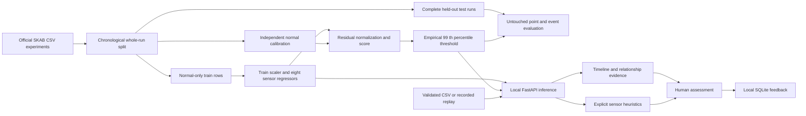

# Architecture

Feedback has no automatic path back into training.

## Components

- `app/train.py`: reproducible data splits, normal-only fitting, thresholds, evaluation, injections and ablations. Saves model and metrics.
- `app/main.py`: FastAPI, locally bound through launch scripts. Loads trusted bundled model once. Whitelists eight features and recorded run paths. Validates CSV before inference. Atomic SQLite transactions persist feedback.
- `app/static/`: dependency-free browser interface. Native SVG renders true scores and raw signal sparklines. Playback is a UI replay clock, never presented as a live plant.
- `app/launch.py`: opens the browser after the local server is accepting connections.
- `app/prognostics.py`: an independent NASA FD001 simulated-turbofan RUL model. Causal degradation-drift features, 5-fold engine-grouped CV model selection, split-conformal 90% intervals, final 100-engine refit, single official 100-engine test. Saved model and endpoint metrics never receive pump data.

The **Failure forecast lab** is a separate equipment profile: engine telemetry → causal current/past 20-cycle features → supervised RUL regressor → predicted remaining cycles. Supplied official test RUL goes only to evaluation and hindsight chart annotations. It has no path into inference. A maintenance horizon compares fixed endpoint predictions and truth, never retrains or selects the model.

## API

| Method / route | Purpose |
|---|---|
| GET `/api/health` | Local readiness |
| GET `/api/metrics` | Full evaluation, split manifest and stress tests |
| GET `/api/runs` | Allowlisted chronological test runs |
| GET `/api/run?name=...` | Score a complete held-out run |
| GET `/api/scenario/{name}` | Recorded/normal/injected replay |
| POST `/api/upload` | Validate and score CSV, no file persistence |
| GET `/api/sample` | Download an accepted sample stream |
| GET/POST `/api/feedback` | Read and append local operator assessments |
| GET `/api/prognostics` | Engine splits, validation, official test scores and horizon metrics |
| GET `/api/prognostics/engine/{id}` | Causal prediction history with explicit benchmark hindsight |
| GET `/api/prognostics/sample` | Independent FD001 engine CSV schema |
| POST `/api/prognostics/upload` | One validated engine trajectory, unknown actual RUL |

CSV accepts comma or semicolon delimiters, UTF-8, and the exact eight upstream feature headers. Optional `datetime` must be valid, unique and ascending. At least 20 rows, at most 1,200 rows, maximum 2 MB. Extra columns, including anomaly labels, are ignored and reported. The original CSV file is not saved, but parsed telemetry and inference evidence are retained in the local SQLite database to support immutable task snapshots. The application rejects malformed values rather than silently imputing them. Pump cadence below 0.9 seconds is unsupported; intervals above 1.5 seconds reset temporal state, and frequent gaps require verification.

Task APIs persist versioned evidence references, lifecycle transitions and reports. Inference IDs are content digests of the profile, source, model/policy versions, warnings and scored observations. `app/evidence.py` reconstructs snapshots on the server. `app/artifacts.py` validates model/report/source hashes at launch. `app/research.py` generates clearly labelled exploratory diagnostics without replacing trained models.

Engine upload is intentionally a **different schema**: engine_id, cycle, three settings and 21 sensor columns. One engine,20–2,000 consecutive ascending cycles,2 MB limit. Finite numeric values, positive integer ID/cycles, no duplicate columns or extra row fields. Extra label columns are ignored and reported. Actual RUL stays null. No inference of sensor compatibility with another equipment class.

## Scope

No external inference, API key or hosted service. No automatic physical actuation. HTTP/CSV is the implemented ingestion boundary; an MQTT adapter can map messages to the same validated stream schema later. The local server has no authentication and must remain on loopback. This is a single-user demonstration, not a hardened service.
